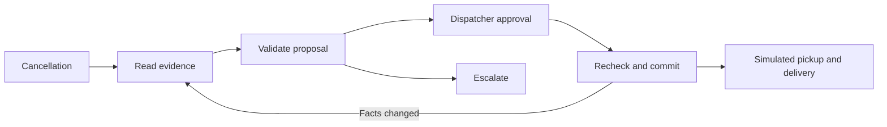

# Logistics Recovery

A dispatcher reviews an agent's evidence-backed recovery proposal after a driver cancels before pickup. Application code enforces custody, availability, capacity, price, deadline and quote expiry; only an authenticated dispatcher can approve an assignment. Retry and restart recovery preserves one booking. Pickup and delivery are explicitly simulated events.

The local prototype is runnable; the current suite passed 136 checks in both verified environments. **Scripted replay** is deterministic and needs no API key. **Live model** uses a configured OpenRouter model; the latest bounded three-case development check matched 2/3 expected outcomes, with one successful recovery and one unnecessary escalation. See [live results](docs/live-results.md). This project demonstrates approval and recovery engineering; live model quality remains a limitation.

## Run locally

Use Python 3.14 (verified on 3.14.8), from this repository's root:

```sh
python3.14 -m venv ../../work/venvs/my-logistics-demo
source ../../work/venvs/my-logistics-demo/bin/activate
python -m pip install -r requirements.lock
python -m pip install -e . --no-deps
export LOGISTICS_DATA_DIR="$(mktemp -d)"
export LOGISTICS_USERNAME=dispatcher
export LOGISTICS_PASSWORD="$(python -c 'import getpass; print(getpass.getpass("Private demo password: "))')"
export LOGISTICS_ORIGIN=http://127.0.0.1:8000
export LOGISTICS_MODE=replay
logistics-recovery seed-demo
python -m uvicorn logistics_recovery.web:build_application --factory --host 127.0.0.1 --port 8000 --workers 1
```

Open http://127.0.0.1:8000 and enter your private credentials. Investigate demo-1, inspect the proposal's evidence, then approve. The assignment status is not delivery completion. Simulate pickup, then delivery; review the incident history. Demo-2 has an infeasible spending limit and escalates. Restart retains data as long as LOGISTICS_DATA_DIR stays the same. For a fresh demo, select a new private directory and seed again; seeding does not erase existing history.

Keep credentials out of source control and screenshots. Runtime files belong outside this repository, in a private directory. Use loopback and one worker. Public hosting requires separately configured HTTPS, spending controls and operational review; no cloud resource is needed for this milestone.

## Verify

```sh
python -m pytest -q
logistics-recovery evaluate --mode baseline --split development --output "$LOGISTICS_DATA_DIR/baseline-development.json"
logistics-recovery evaluate --mode replay --split development --output "$LOGISTICS_DATA_DIR/replay-development.json"
logistics-recovery evaluate --mode replay --split held-out --output "$LOGISTICS_DATA_DIR/replay-held-out.json"
```

[Results](docs/results.md) preserve scenario counts, denominators, hashes and limitations. Both offline modes matched 50/50 expected outcomes. The 10 held-out cases are synthetic parameter variants reserved from workflow/prompt iteration, not a generalization benchmark. No live-model superiority, production security guarantee or delivery-cost savings are claimed.

## How it works

FastAPI serves two authenticated views. LangGraph retrieves records through five read-only tools, validates a proposed recovery, persists a pause for approval, then commits through the business service. SQLite stores business records and a separate SQLite database stores graph checkpoints. The business assignment is authoritative when a checkpoint lags a successful commit. Six persisted model attempts and three proposal drafts cap each incident.



Local replay computes a plan from the current tool results, including capacity already reserved by other incidents. Revisiting a stale waiting proposal reopens investigation within the same attempt budget and requires a new approval. The immutable approval binds the proposal, incident version and cited record versions. Approval consumption, capacity reservation, unique assignment and audit event share one transaction. Stale facts require a new proposal and approval. Notes are untrusted; prompt instructions never grant authority. See the [threat model](docs/threat-model.md).

## Live model and budget

The overall personal budget is $35; the initial model-credit checkout ceiling is $12 including fees, with no automatic top-ups. No purchase or cloud usage occurred. LangGraph runs locally without a paid hosting plan. Google Cloud credits are optional and time limited.

For live mode, first verify the selected model's tool-calling support and current official input/output rates, set a provider key/account spending limit within the remaining cash budget, then privately set OPENROUTER_API_KEY and OPENROUTER_MODEL and LOGISTICS_MODE=live. Start with one incident. The estimate command sends no requests:

```sh
logistics-recovery estimate --cases 1 --input-rate INPUT_USD_PER_MILLION --output-rate OUTPUT_USD_PER_MILLION
```

Deterministic protocol fault cases are excluded from live model-quality comparison and reported as skipped; client enforcement is tested offline. A live batch additionally requires --confirmed-provider-settings, --live-budget-usd, --input-rate and --output-rate. The estimate assumes 12,000 input tokens per attempt; it is not a guaranteed bill. The provider spending limit is the hard monetary boundary. Failed requests count against the six-attempt incident budget; absent usage remains unknown. Do not use free-tier availability as a reliability assumption.

## Portfolio evidence

[Case studies](docs/case-studies.md) explain a lost-response recovery, ambiguous custody correction and approval boundary. [Demo script](docs/demo-script.md) gives a three-minute walkthrough. [Employer principles](docs/employer-principles.md) ties the review priorities to published engineering expectations. [Judgment tracker](outputs/engineering-judgment-tracker.md) separates agent findings, deliberate fault tests and the builder's own confirmed contributions. Agent-made corrections cannot be claimed as personally diagnosed until the builder does and records their own review.

[Interview preparation](docs/interview-answer.md) explains the response-contract diagnosis, bounded revisions and verification strategy. It is an assistant-written draft, with attribution kept separate from the builder's own review.

This is one depot, one dispatcher and one complete delivery job per incident. There is no route optimizer, real courier integration, account registration, distributed graph coordination or schema migration framework. Use fresh synthetic runtime storage after schema changes. Dependencies are version pinned, not cryptographically hash locked. Never feed sensitive production or healthcare data into this demo.
