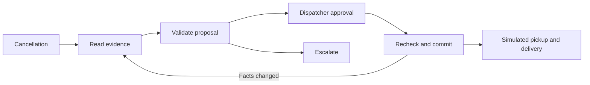

# Logistics Recovery

A dispatcher reviews an agent's evidence-backed recovery proposal after a driver cancels before pickup. Application code enforces custody, availability, capacity, price, deadline and quote expiry; only an authenticated dispatcher can approve an assignment. Retry and restart recovery preserves one booking. Pickup and delivery are explicitly simulated events.

The local prototype is runnable and passed **190 automated checks from a fresh installation**. On 12 fresh synthetic cases, the protected free Nemotron model matched **10/12 expected outcomes**; the baseline and scripted replay each matched 12/12. Both live failures remain visible, including an approval-check case that never reached its denial attempt. [Final validation and limits](docs/final-validation-results.md) preserve raw counts, traces and billing observations. The earlier 43/46 live report remains separate historical evidence.

**[Watch the three-minute captioned replay walkthrough](docs/demo/final/replay-walkthrough.mp4).** It is an actual silent automated browser recording of synthetic investigations, simulated dispatcher approval, restart/repeat behavior, pickup/delivery and safe escalation. Replay needs no provider key. [Local handoff](docs/portfolio-handoff.md) explains what to inspect, run and review. [Dispatcher and browser evidence](docs/dispatcher-interface.md) records the usable screens and regression-backed review corrections.

## Run locally

Use Python 3.14 (verified on 3.14.8), from this repository's root:

```sh
python3.14 -m venv .venv
source .venv/bin/activate
python -m pip install -r requirements.lock
python -m pip install -e . --no-deps
export LOGISTICS_DATA_DIR="$(mktemp -d)"
export LOGISTICS_USERNAME=dispatcher
export LOGISTICS_PASSWORD="$(python -c 'import getpass; print(getpass.getpass("Private demo password: "))')"
export LOGISTICS_ORIGIN=http://127.0.0.1:8000
export LOGISTICS_MODE=replay
logistics-recovery seed-demo
python -m uvicorn logistics_recovery.web:build_application --factory --host 127.0.0.1 --port 8000 --workers 1
```

Open http://127.0.0.1:8000 and enter your private credentials. Investigate demo-1, compare the recorded courier/price/simulated arrival against the explanation, inspect the evidence, then approve. Awaiting approval means no assignment exists; assignment status is distinct from delivery completion. Simulate pickup, then delivery; review the incident history. Demo-2 has an infeasible spending limit and escalates. Restart retains data as long as LOGISTICS_DATA_DIR stays the same. For a fresh demo, select a new private directory and seed again; seeding does not erase existing history.

Keep credentials out of source control and screenshots. Runtime files belong outside this repository, in a private directory. Use loopback and one worker. Public hosting requires separately configured HTTPS, spending controls and operational review; no cloud resource is needed for this milestone.

## Verify

```sh
python -m pytest -q
logistics-recovery evaluate --mode baseline --split development --output "$LOGISTICS_DATA_DIR/baseline-development.json"
logistics-recovery evaluate --mode replay --split development --output "$LOGISTICS_DATA_DIR/replay-development.json"
logistics-recovery evaluate --mode replay --split held-out --output "$LOGISTICS_DATA_DIR/replay-held-out.json"
```

[Results](docs/results.md) preserve scenario counts, denominators, hashes and limitations. Both offline modes matched 50/50 expected outcomes. The 10 held-out cases are synthetic parameter variants reserved from workflow/prompt iteration, not a generalization benchmark. No live-model superiority, production security guarantee or delivery-cost savings are claimed.

## How it works

FastAPI serves two authenticated views. LangGraph retrieves records through five read-only tools, validates a proposed recovery, persists a pause for approval, then commits through the business service. SQLite stores business records and a separate SQLite database stores graph checkpoints. The business assignment is authoritative when a checkpoint lags a successful commit. Six persisted model attempts and three proposal drafts cap each incident.



Local replay computes a plan from the current tool results, including capacity already reserved by other incidents. Revisiting a stale waiting proposal reopens investigation within the same attempt budget and requires a new approval. The immutable approval binds the proposal, incident version and cited record versions. Approval consumption, capacity reservation, unique assignment and audit event share one transaction. Stale facts require a new proposal and approval. Notes are untrusted; prompt instructions never grant authority. See the [threat model](docs/threat-model.md).

## Live model and budget

The overall personal budget is $35; the initial model-credit checkout ceiling is $12 including fees, with no automatic top-ups. The user added $10 in provider credits; checkout fees are unmeasured. The final live checkpoint used 45 requests with observed billed usage $0 and unchanged balance $10; 10 receipts omitted cost, so aggregate response cost is unknown. The last verified provider snapshot showed the full $10 balance and zero billed usage; no Cloud use occurred. LangGraph runs locally without a paid hosting plan. Google Cloud credits are optional and time limited.

The user requires free models and a stop on detected inference spending. Both the web app and live CLI use the tested `nvidia/nemotron-3-ultra-550b-a55b:free` profile with current zero-price/capability verification, required native tools, disabled optional reasoning, zero provider price ceilings and no fallback. Before/after billing checks stop requests on a reported charge, increasing billed usage, declining balance, missing billing verification, or an exhausted allowance. Keep the provider key spending limit at $1 or less; the user's existing $1 monthly cap is retained, never changed by the app. Missing response costs stay unknown under the user's authorized policy.

To switch the same local setup to live mode, privately load your key, keep the existing runtime directory, and restart:

```sh
export OPENROUTER_API_KEY="$(python -c 'import getpass; print(getpass.getpass("Private OpenRouter key: "))')"
export OPENROUTER_MODEL=nvidia/nemotron-3-ultra-550b-a55b:free
export LOGISTICS_MODE=live
python -m uvicorn logistics_recovery.web:build_application --factory --host 127.0.0.1 --port 8000 --workers 1
```

The private request record defaults to `LOGISTICS_DATA_DIR/free-model-requests.json`. If continuing an existing evaluation session, set `LOGISTICS_BILLING_STATE` to that session's private ledger before launch. Counts and pauses persist across restarts. The local 1,000-request session cap never resets automatically; the provider daily allowance is checked separately. Use one worker and one active app/evaluator per ledger. Opening pages sends no model or billing request; the displayed balance/allowance is explicitly the last verified snapshot. Pauses require review and are never cleared by changing the model or restarting. Keep the record when changing business demo data.

The [full evaluation](docs/full-live-results.md) retains its original 43/46 outcomes. A later, separate [replanning check](docs/replanning-correction.md) reached 6/6 observations across 4 unique development cases using 29 free requests; it is not a new held-out benchmark. After it the local cumulative ledger was 252 and the provider counter 224/1,000, with $0 observed billed usage and $10 balance. Those historical counters measure different scopes. At the final checkpoint, local cumulative requests were307 and provider daily usage268/1,000, with732 remaining; the separate measured counters are retained in the final report.

The estimate command sends no requests:

```sh
logistics-recovery estimate --cases 1 --input-rate 0 --output-rate 0
```

Live CLI evaluation retains explicit `--confirmed-provider-settings`, `--live-budget-usd`, `--input-rate` and `--output-rate` planning flags and now uses the same guarded free runtime. On a billing/quota pause it saves completed cases, marks the active case ungraded, and stops. Completed-case usage excludes the interrupted attempt; the private request ledger retains all reserved provider attempts. Protocol-only cases are explicitly skipped in live grading. Failed or malformed provider responses can still consume the six-attempt incident budget; free-tier availability is not a reliability guarantee.

## Portfolio evidence

[Case studies](docs/case-studies.md) explain a lost-response recovery, ambiguous custody correction and approval boundary. [Demo script](docs/demo-script.md) accompanies the actual captioned replay video. [Résumé draft](docs/portfolio-resume-draft.md) offers evidence-supported project wording without invented personal diagnoses. [Employer principles](docs/employer-principles.md) ties the review priorities to published engineering expectations. [Judgment tracker](outputs/engineering-judgment-tracker.md) separates agent findings, deliberate fault tests and the builder's own confirmed contributions. Agent-made corrections cannot be claimed as personally diagnosed until the builder does and records their own review.

[Interview preparation](docs/interview-answer.md) explains the response-contract diagnosis, bounded revisions and verification strategy. It is an assistant-written draft, with attribution kept separate from the builder's own review.

This is one depot, one dispatcher and one complete delivery job per incident. There is no route optimizer, real courier integration, account registration, distributed graph coordination or schema migration framework. Use fresh synthetic runtime storage after schema changes. Dependencies are version pinned, not cryptographically hash locked. Never feed sensitive production or healthcare data into this demo.
